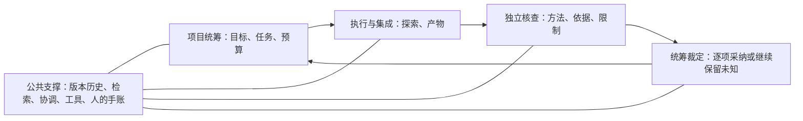

# AI-REOS：可追溯的项目工作框架

这是可运行的 **2.0.0-alpha.1 预览版**，由本地0.4.0原型继续发展。默认没有项目事实、任务、节点、模型渠道或凭据。先在空项目或明确边界的真实任务中试用，再决定是否迁移整个项目。

GitHub旧1.5.0安装包完整保留于[旧版归档](https://github.com/qiao233666/AI-REOS/tree/main/legacy/kit-v1.5.0)，旧标签与提交保留；此版不是旧bootstrap的直接覆盖升级。版本与兼容说明见[CHANGELOG](CHANGELOG.md)。

它把工作分成三个责任区：**项目统筹**决定做什么及采纳什么；**执行与集成**产出候选；**独立核查**检查具体产物。三者共用历史、检索、输出协调、工具目录和阶段手账。审核通过不会自动变成正式结论。



建议先看 [概念说明](docs/CONCEPTS.md)，再看 [修订设计](docs/DESIGN.md) 和 [Astra 意见处理](docs/REVIEW_DECISIONS.md)。实际工作规则在 [操作协议](docs/PROTOCOLS.md)，命令在 [CLI 说明](docs/CLI.md)。测试结果见 [验证报告](verification/REPORT.md)。

本次更新用现成的 SQLite 全文检索保存机器可查的历史，保留可选的本地语义检索；人的阶段手账继续单独展示。文件快照、索引更新、交付登记、核查录入和结案由程序完成，不需要模型持续照看框架。AI 负责说明做了什么、提供判断与依据，有权角色负责审核和采纳。见 [本地记忆与操作说明](docs/LOCAL_MEMORY_USAGE.md) 和 [本次审查处理](docs/LOCAL_MEMORY_REVIEW.md)。

0.3针对AI取用效率增加默认短片段、命中位置、对象去重及小型文本文件自动索引；已知正式编号直接定位，不加载向量编码器。复核次数在开始时预留，运行文件支持有界快照、校验和新目录恢复；状态分别展示执行、审核、采纳及依据。现有技术的借用和取舍见[机器记忆说明](docs/MACHINE_MEMORY.md)。

0.4.0收紧实际核查版本及依据资格，允许新材料经过独立初核和统筹批准后有历史地续查；运行恢复包含空目录，外部报告先限额采集再解析，语义扩搜保留已见候选。兼容变化与验证边界见[本轮审查处理](docs/REVIEW_0_4_0.md)。

本预览版新增[旧账本接入](docs/HISTORY_BRIDGE.md)：程序按编号为YAML/Markdown大账本建立索引，保留行段与原文快照；旧记录不自动变成新版审核通过。`session-context`给有界导航，索引与记账由程序维护。

## 直接运行

需要 Python 3.10 或更新版本，以及支持 FTS5 trigram 的 SQLite；默认模式只用 Python 标准库。可选语义通道另外安装依赖并预置模型。下面的 `python` 应替换为实际可用的解释器。

```text
cd <框架目录>
python -B -m aireos --help
python -B scripts/verify.py
python -B examples/demo.py --project <尚不存在的示例目录>
python -B examples/batch_demo.py --project <另一个尚不存在的示例目录>
```

示例实际调用命令行，完成登记脚本、运行合成统计、保存产物、核查、采纳、阶段说明及历史追溯；不会调用付费模型或远端计算。示例程序中的核查断言只演示流程，不是实际科研独立审查。

初始化真正的空项目只创建框架记录和管理员凭据，不创建任何示例事实：

```text
python -B -m aireos --project <新项目目录> init
```

初始化会返回凭据文件位置。管理员显式委派执行、核查、采纳等能力；常规执行者不要拿管理员凭据。CLI 不会自动加载管理员凭据。要在其他工作目录调用，可以安装本包，或把框架目录加入本次进程的 `PYTHONPATH`。

## 目前实现

| 需要解决的问题 | 当前做法 |
|---|---|
| AI 忘记历史、反复重做 | FTS5索引覆盖旧版正文、别名和编号，带回显式依赖、更正和争议；可选离线语义通道；未命中不能判定不存在 |
| 维护框架占用太多模型操作 | 一次交付、核查录入及结案各有固定入口，程序登记并支持失败恢复；不会代替审核判断 |
| 输入变了仍沿用旧结果 | 任务输入固定文件字节或对象版本，相关变化使收据失效；成果也持续检查声明依据 |
| 一次执行中的猜测覆盖可靠成果 | 候选、核查意见、采纳决定分开；依据变化和实质争议使下游待复核 |
| 状态文件只加不减又有上限 | 当前状态是有上限的导航；完成或停止的任务退出当前列表，历史原文与快照保留 |
| 人读不懂电脑账本 | 阶段手账用简短普通话说明做了什么、有什么用、还缺什么；条目追到当时版本和现在变化 |
| 多执行者互相覆盖 | 按解析后的实际目录判断重叠；占用、交付及接管核对路径指向和代次 |
| 争议反复花费审核次数 | 调用前预留次数，同请求不重复扣；外部案件调用绑定一次预留，不自动退还未知调用 |
| 运行日志后改、难以恢复 | 有界保存字节快照和清单，可校验并恢复到新目录；超量及未知终态明确标partial |
| 计算资源凭口头指认 | 稳定节点身份、能力标签、容量和可用性；未知作业占用不会因超时自动释放 |
| 重复写脚本 | 有版本、用途、别名、输入输出、维护者、依赖及验收说明的工具目录；登记不导入代码 |
| 外部审核只有读权限 | 审核材料包使用 `workspace-write`，允许实际运行和写入；调用、日志、报告及未知终态留痕 |

## 使用边界

本版验证的是本地单一权威目录中的工作流与合成反例。此前22条私有材料、14题定位试验中，全文首位命中14题、混合检索首位命中11题；另8条合成材料、4题改写/编号示例中，全文首位命中1题，混合首位命中3题、前三位命中4题。两组测试衡量不同能力，都不能证明总体性能。因此保留无模型依赖的FTS默认，提供显式启用的混合通道；有本地模型的试点应同时核对改写召回和精确条件。人的理解、科学正确性、跨机器一致性和实际费用节省尚未实证。

凭据只约束受管入口；同一操作系统用户仍可能直接读管理员密钥或改数据库。脚本和外部 CLI 的操作系统隔离由宿主负责。此框架没有把模型名称当成权限或保证。

SQLite 权威目录放本地可靠磁盘；不支持把数据库放在网络共享盘上冒充分布式数据库。首版资源功能只做选择和占用登记，不自动 SSH、启动求解器或取消远端作业。外部审核默认使用可写临时材料包，未实现原仓库直接读写模式。

维护、备份及后续迁移门槛见 [维护说明](docs/MAINTENANCE.md)。
