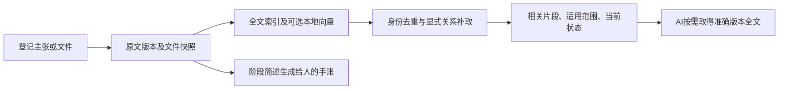

# 从AI取用效率设计机器记忆

机器记忆保留原文、版本及关系，按问题送入有限片段；人的阶段手账继续是另一种展示。向量是检索器使用的数字表示，AI最终阅读的仍是相关原文、条件和来源，不需要把向量数组放进上下文。

## 采用的现有工作

| 工作 | 实际采用及取舍 |
|---|---|
| SQLite FTS5 | 实际使用其全文索引与排序，保存历史版本；少量双字术语有受限匹配补充。 |
| [Qdrant混合与分阶段检索](https://qdrant.tech/documentation/search/hybrid-queries/) | 实际使用Qdrant Client嵌入式库及FastEmbed本地编码；全文和向量按排名融合，保留精确身份优先。没有安装额外重排模型，也没有将原始分数直接相加。 |
| [Letta状态与记忆](https://docs.letta.com/v1-sdk/concepts/stateful-agents#memory) | 借鉴小量常驻上下文、完整历史外置并可按需取回的分工；未集成其代理服务或自行编辑核心规则的机制。 |
| [Mem0写入流程](https://docs.mem0.ai/core-concepts/memory-operations/add) | 核对了其结构化抽取及原文存储方式。默认抽取需要LLM；本项目以已有交付内容和确定性文件索引替代持续自动抽取，未集成Mem0服务。 |
| [LongMemEval](https://github.com/xiaowu0162/LongMemEval) | 借鉴知识更新、时间、多记录推理和无法回答等评测维度。没有运行其完整模型问答评测，不能把本地小试验称为通过该基准。 |

现成检索组件解决“找哪些候选”；原文保留、适用范围、版本变更、争议、采纳及人的追溯仍由项目记录表达。语义相似不能自行判定哪个结论正确。

## 当前机器取用方式

- 登记小型UTF-8文本文件时直接索引原文，支持Markdown、文本、代码及常用配置表格；256KiB以内。无需AI再写一遍机器摘要。大型及二进制文件保留字节快照，但仅索引元信息，覆盖范围明确返回。PDF/OCR、全仓自动扫描尚未实现。
- 默认brief返回最多600字符的原文片段、记录及版本、字符位置、适用范围和当前状态；有限显示中有省略就标partial。片段从字面命中附近截取，没有字面命中的语义候选给开头并明确部分显示，不假装由模型提炼。
- 全文和短词通道都在数据库中先为每条记录选出最佳匹配历史版本，再限制不同记录的候选数。0.3.1不再先截取版本行；历史原文仍能命中，再带回当前版及更正关系。身份候选池和最终返回仍有限额，明确报告截断；检索不保证一般语义召回或无限历史的固定延迟。
- 已知正式ID直接定位，不加载语义编码器；自然问法在显式配置hybrid后同时找词面和语义候选。已有向量与相同查询复用缓存，不运行后台对话模型。
- 0.4.0语义候选先归并切片和历史版本，按身份保留最佳匹配版本，再限制候选数。点数不足以得到足够身份时逐步扩搜，跨轮累积已校验候选，不要求近似检索结果为严格前缀。每次查询最多核对4096个不同点，累计返回条目（含重复）不超过12288；metadata分别报告实际扫描、返回条目、身份池截断与最终输出截断。到上限只能说明检索不完整，不能推断不存在其他历史。
- full取得完整正文；get按id/rev取得完整正式对象；收据保留完整版本摘要。不会用裁剪后的片段替换历史或证明模型已读全。

## 验证与取舍

此前22条私有历史材料、14题定位试验中，全文首位14/14，混合首位11/14、前三位14/14。另8条合成材料、4道改写和编号题中，全文首位1/4，混合首位3/4、前三位4/4。后者展示换说法时向量的用途，不能覆盖前者或推断一般优劣。两套语料没有混用或拿来调参追分。

当前保留无额外依赖的全文默认。具备本地模型的项目可显式启用混合通道，再用自己的改写问法、精确编号、条件否定、更正及未知问题验收。对话模型不负责维护索引；更复杂重排和自动因果抽取仍须先证明值得增加计算及维护成本。

最终源码下单个合成长记录的显示对照：full响应14449字符，brief响应1709字符，下降约88.2%；原文、引用和命中片段保留。该结果只说明这个例子的传入文本量变少，不是token、账单或总体答案质量的测量。具体结果见验证目录的packet-size-final-03及semantic-examples-final-03报告；旧试测也保留。

## 已修补的维护问题与边界

复核先预留次数，再允许案件外部调用；结案不再计次。日志和普通小型输出保存快照，可校验并恢复到新目录；超量、读取失败和未知终态标partial，恢复中断可按持久请求接续。目录别名在占用、交付及接管中使用实际路径并检查指向变化。状态分开呈现执行、审核、采纳、依据和知识类型。

仍未实施：提供方实际费用统计及跨入口费用封顶、完整科研问答质量评测、跨机器分布式一致性、整个项目自动迁移。底层绕行及同用户强隔离按使用者要求暂缓。工作流测试通过不能代表科研结论已验证。

本轮语义扩搜验证使用内存SQLite及确定性假客户端，未加载真实编码模型，不能声称当前0.4.0的真实Qdrant/FastEmbed兼容性或召回率已重新验证。模型目录检查及已有向量同步仍会随历史规模增长，待真实试点评估，不以此次候选修补替代规模测量。
