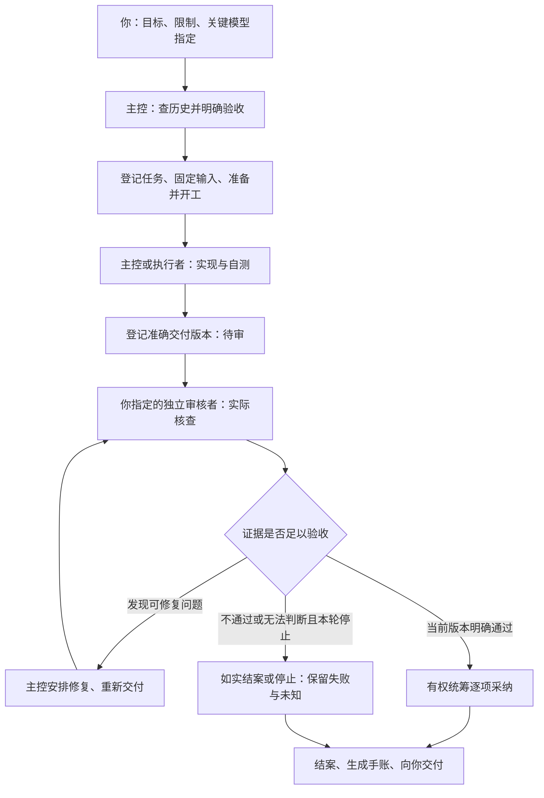

# AI-REOS 运行指南：从你交任务到最终完成

适用范围：2.0.0-alpha.5 已实现的通用框架。本文先讲用户与模型怎样协作，再对应实际程序入口。它不要求你阅读源码或自己维护机器账本。

**日常用法是：你给当前对话模型交任务并指定关键角色使用的模型；当前模型组织执行、独立审核、返修与验收，程序保存各步的版本和记录。三个责任区表示三种职责，不要求同时开着三个 AI。**

当前没有“接到一句话就自动选择所有模型并运行到底”的调度服务。模型需要主动调用框架入口；模型选择、人工授权、审核判断和采纳决定也不能由数据库替代。

## 阅读顺序

- 想马上开始：看[怎样派发](#1-你怎样派发一个任务)和[完整例子](#3-一个任务从开始到结束的完整例子)。
- 想知道谁负责什么：看[职责与模型](#2-主控执行审核分别是谁)。
- 想知道怎样才算完成：看[完成的含义](#4-写完通过采纳和结案分别是什么意思)。
- 想找手账、旧工作或中途接手：看[记录与接续](#6-记录保存在哪里下次怎样继续)。
- 负责接入或实际操作：看[入口速查](#8-实际入口怎样对应上述流程)。

## 1. 你怎样派发一个任务

你可以直接在正在使用的模型会话里说：

> 给项目增加一个结果检查脚本，检查缺失文件和参数不一致，不改原始结果。主控就是当前会话模型；独立审核使用我指定的 6.1 Sol，通过已获准的外部调用渠道进行。辅助执行子代理由你安排，遵守项目的数量和权限限制。完成后告诉我怎么用、验证了什么、还有什么限制，并更新阶段手账。

模型名称只是这个例子的人工选择。你可以指定其他模型或渠道；框架没有内置“某个型号永远是主控或审核”的对应关系。

你主要提供目标、重要限制，以及关键职责使用的模型。主控负责补齐常规任务细节、查旧工作、调用工具、组织审核和留下记录。只有缺少会影响结果的关键要求，或者需要扩大已有授权时，才需要再找你确认。

关键模型的选择与辅助子代理分派分开处理：

| 事项 | 谁决定 | 主控怎样做 |
|---|---|---|
| 当前主控使用哪个模型 | 你选择当前会话或另行指定 | 在该会话中承担统筹职责，不把自己自动升级成另一个模型 |
| 独立审核使用哪个模型、什么渠道 | 由你指定，或沿用你已授权且仍适用的安排 | 到审核环节调用相应工具；也可以接收你从另一个会话带回的真实报告 |
| 专门承担关键工作或复杂实现的模型 | 以你对本任务的指定为准 | 不擅自用辅助分派替换你指定的执行方 |
| 是否需要辅助子代理、怎样拆辅助工作 | 在授权范围和项目规则内由主控安排 | 不要求你逐条派发；不超出数量限制，不让多个执行方同时写同一文件 |
| 文件范围、科研计算、联网、外发和费用 | 服从本任务及已有授权 | 新任务记录、换模型或得到审核通过，都不自动扩大权限 |

没有指定审核模型且没有可沿用的授权时，主控可以先推进不依赖它的工作，到需要外审前向你确认。不能仅凭某个工具自带的默认模型就推定你已经选好了。

## 2. 主控、执行、审核分别是谁

**主控就是负责接下你的目标并组织完成它的模型。** 通常是你正在对话的那个。它查历史、界定任务、安排执行、准备审核、处理意见，并在有权范围内决定采纳什么，最后向你交代结果。

**执行者负责产出。** 主控可以自己执行，也可以委派一个辅助子代理；复杂任务还可以按你指定的执行模型安排。执行者交回文件、实际操作、验证结果和限制，不能把自己的自测写成独立审核。

**独立审核者负责检查产出。** 它针对准确版本查代码、来源、推理及适用条件，必要时实际运行程序、复算或制作反例。主控准备的总结是线索，不能代替实际检查。

常见的两种安排是：

| 任务安排 | 实际模型会话 | 适合的情况 |
|---|---|---|
| 主控兼执行，加一个独立审核会话 | 两个会话先后工作 | 边界清楚、主控自己能够完成的任务 |
| 主控加执行者，再交独立审核会话 | 三种职责先后衔接 | 工作较大，或执行与统筹需要分开 |

这不是三个常驻 AI。项目若限制最多一个子代理，就顺序安排辅助执行与审核，不同时堆叠多个辅助模型。实际数量、并行方式和模型权限以项目规则为准。

程序要求交付执行身份与独立审核身份分开；但换身份、开新会话或换型号，都不能单独证明核查独立。报告仍须写明真实审查者、检查方法、来源和实际做过的验证。主控整理外部报告时不能把自己没有做过的检查登记成已经完成。

## 3. 一个任务从开始到结束的完整例子

继续使用“结果检查脚本”这个例子。以下是流程说明，不是在任何实际项目中发起计算或调用付费模型。



图中的最后一条路径表示结束本轮投入，不表示任务已成功完成。

### 第一步：主控先查旧工作与教训

主控读取简短导航，然后围绕本任务查三类材料：已有实现、失败教训、历史决定及后续更正。例如先确认有没有现成的检查脚本，有没有“参数缺失却被当成正常”的旧问题。

检索默认返回有上限的片段和来源状态。关键格式、条件和结论需要按准确来源展开；未命中只能说尚未找到，不能据此认定以前没有做过。

**这一步的结果：** 找到可复用内容、风险及仍不清楚的条件，而不是立即从零写代码。

### 第二步：主控界定可验收的任务

一个任务最好对应一个能单独交付、核查和结束的阶段。较长研究拆成几个这样的阶段，不把整个项目写成一个永远无法验收的任务。

本例可以约定：

- 交付检查脚本、使用说明和必要测试。
- 缺文件、参数缺失和参数不一致都给出明确诊断。
- 不改原始结果，不启动新的科研求解。
- 用正常样例和故意有问题的样例检查；正常材料不能误报，问题材料不能漏报。
- 超出已知格式或遇到不能确认的字段时明确报未知。

主控通过 `create-task` 保存目标、输入、输出路径、验收要求、预算和停止条件。已有材料要区分“作为依据”和“待研究或待反驳的参考”，不能把旧记录全部默认当成可靠依据。

**这一步的结果：** 有一个清楚的任务约定，之后按它验收，不在做到一半时悄悄改成功标准。

### 第三步：准备开工，再执行与自测

执行前通过 `prepare` 检查任务相关历史、约束和来源版本，取得开工收据，再由 `start-task` 核验后进入执行。收据是程序保存的“本次按哪些材料和条件开工”的记录。

主控自己实现，或者把明确范围交给执行者。执行者先复用已有工具，完成后实际运行必要的便宜检查；大型计算仍按原授权和资源安排执行。

输入、目标或范围发生重要变化时，应重新核对任务约定。更换检索词或重新生成收据不能偷偷接受已经变化的固定输入。

**这一步的结果：** 得到候选实现、操作记录、自测结果及限制。自测通过还不是独立审核通过。

### 第四步：主控登记准确的交付版本

执行者或主控使用 `deliver-batch` 一次提交文件和需要登记的结论，程序完成文件快照、来源及交付登记。大任务可以有多个交付项，例如脚本、验证报告和一个有适用范围的结论。

主控为审核者整理：原始要求、待审文件及版本、已有验证命令与结果、需要重点检查的问题。交付项此时处于待审状态，不能把“已经写完”直接说成“已经验收”。

**这一步的结果：** 审核者面对的是明确版本，而不是会随着执行者继续修改而变化的一堆文件。

### 第五步：按你的指定组织独立审核

主控通过获准渠道调用你指定的模型，或等待你从另一个会话提供报告。审核者可以在授权目录中读写、运行测试、制作反例和替代实现；相关科研计算与外发仍需已有授权覆盖。

本例审核不应只问“代码看着对吗”，还应检查：

- 用正常样例，是否会误报？
- 用缺文件、缺字段、参数冲突等反例，是否会漏报？
- 对未知格式，是否如实说明无法判断？
- 运行检查后，原始结果是否保持原样？

审核报告记录实际模型和渠道、所审版本、检查方法、命令、结果及限制。之后通过 `record-reviews` 逐项录入真实意见。录入程序不会自己阅读代码并生成判定。

**这一步的结果：** 每个交付项都有具体版本对应的核查意见；不是一句笼统的“高级模型看过了”。

### 第六步：主控处理意见，需要时返修

假设审核者发现参数缺失会被误报为正常。主控核对反例，安排修复，并补上能够暴露这个问题的测试，再登记新的交付版本。

改过的交付需要重新核查；不能把旧版本通过意见套在新版本上。文件内容变化应重新登记快照；文字修订也保留旧版。已结束任务的后续修改另建任务，不改写原来的完成记录。

普通返修不必把每个小修改都写成一个新研究项目；但目标、验收、固定输入或范围改变时，要明确新任务约定。重复调用使用稳定请求身份进行恢复，新的材料或新的审核尝试使用新的请求，不能混淆重试与新工作。

如果双方结论冲突，先核对条件、版本和反例。无法判断时保留未知，遵守预算与停止条件；不能为了拿到通过意见不断换模型或重复付费提交。

**这一步的结果：** 问题得到有证据的修复，或者明确记录本轮仍未解决什么。

### 第七步：逐项决定采纳与结案

审核明确通过后，有采纳权限的主控或项目负责人按任务验收要求决定采纳哪些交付。框架检查所引审核是否对应当前版本，文件与依据是否仍有效，以及是否存在未解决的正式争议。

本例只有符合验收要求的脚本及有支持的结论才进入正式采纳。部分适用的内容应明确其范围，不能把“有限通过”直接当成整个交付的通过；需要时缩小范围、重新形成交付并核查。

`finalize-task` 根据明确采纳清单结束阶段，并发表面向人的记录。没有通过的工作也能如实结案；无法继续时可用 `stop-task` 记录停止原因。二者都不能把失败或未知改成成功。

**这一步的结果：** 任务状态、审核意见、采纳情况和未决问题分别有记录。

### 第八步：程序生成手账，主控向你交付

主控提供一两句普通话阶段说明，例如：

> 增加了结果完整性与参数一致性检查，能减少逐项人工核对。已验证约定格式下的正常与异常样例，其他格式仍需另行检查。

程序从正式记录导出阶段手账和简短状态导航。主控最终告诉你：成果在哪里、怎样使用、实际验证了什么、审核发现并修复了什么、还存在哪些限制。

你无需逐项搬运文件或维护内部编号，也不需要自己重写机器账本。需要你最终确认的高影响事项，仍按本任务已有约定处理。

## 4. 写完、通过、采纳和结案分别是什么意思

| 说法 | 实际含义 | 仍不能推出什么 |
|---|---|---|
| 执行完成、已交付 | 候选产物已形成并保存具体版本 | 不等于已经独立审核 |
| 审核通过 `pass` | 指定版本在所写方法与范围内通过检查 | 不等于自动采纳或普遍正确 |
| 有所限制 `limit` | 有限制或条件尚未解决 | 不能直接作为明确通过的采纳凭据 |
| 不通过 `fail` / 无法判断 `unknown` | 找到问题，或证据不足 | 不意味着历史被删除，也不该包装成成功 |
| 已采纳 | 有权责任人按通过意见和当前依据接受具体成果 | 不授予新计算、外发或部署权限 |
| 已结案 `closed` | 本阶段交付已有质量意见，结束本轮工作 | 失败或未知也能结案，不等于目标已经达到 |
| 已停止 `stopped` | 保存停止原因与未决事项 | 不证明外部作业已经停止或资源已经释放 |

对你报告“这项任务成功完成”时，应能对应事先的验收条件、交付、必要核查和采纳。阶段结束与研究问题解决要分开讲。重大发现是否需要你的最终确认，以你授权的采纳范围为准。

## 5. 哪些由程序做，哪些由 AI 或人做

| 环节 | 已有程序负责 | AI 或人的责任 |
|---|---|---|
| 接手与历史检索 | 返回有界导航、检索命中、来源与已登记更正 | 选择问题与同义词，展开关键条件，判断是否适用 |
| 开工 | 保存任务与输入版本，核验开工收据和输出范围 | 设定合理目标、验收、预算和停止条件 |
| 实现 | 提供版本化工具、运行和记录入口 | 写代码、分析问题、运行获准检查 |
| 审核 | 固定材料与版本，保存调用和逐项意见 | 你指定关键模型；主控安排调用；审核者真实核查 |
| 采纳 | 拒绝不匹配版本、未明确通过及失效依据等情况 | 有权角色判断证据是否足够及采纳范围 |
| 记录与展示 | 保存快照、更新派生索引、生成导航与手账 | 写准确、普通人能理解的阶段说明 |
| 中断恢复 | 用同一请求识别已经完成的受管步骤 | 核实真实进程、外部作业和计费状态，不盲目重跑 |

目前没有常驻记忆管理 AI、自动挑选所有模型的调度器，也没有“任务结束就自动叫固定高级模型”的后台触发器。主控依照规则主动调用接口，程序检查已实现的边界并处理机械工作。任何模型是否认真查历史、正确理解材料、认真审查，仍需要实际行为和证据支撑。

脚本应优先承担重复、确定的工作；模型集中处理研究、设计、异常和判断。目录登记、模型名称或文档措辞本身不会让普通文件操作自动受管。

## 6. 记录保存在哪里，下次怎样继续

### 给程序和 AI 的正式历史

每个已初始化项目自己的 `.aireos` 保存正式记录、版本、来源快照和运行证据。通用框架源码库只放程序、文档、模板与合成示例，不应充当真实项目的事实库。

旧账本可以按[旧账本接入说明](HISTORY_BRIDGE.md)登记、索引和追溯；其原文及更正保留。旧版“已完成”、一次检索命中或一个短摘要，不会自动转换成新版审核通过。

### 给你看的阶段手账

通用框架发表视图时，生成 `.aireos/views/<批次>/JOURNAL.md`，包含该批次发表时的全部阶段。`.aireos/views/CURRENT` 指向当前发表批次；同批次还有有界的 `STATE.md` 导航。它们是正式记录的展示，不是让人直接改写的事实源。

项目适配层可以把同一手账导出到更方便的位置。例如已经接入的 SoundVortex 使用项目内 `aiops/aireos/JOURNAL.md`。这是项目适配层提供的固定入口，通用源码不会在所有项目中自动创建该路径。

你可以说“解释手账这一条当时做了什么”。AI 用条目中的阶段身份调用 `trace`，恢复当时任务、产物版本、核查及采纳，并对照现在的复用状态。后续更正追加关联记录，保留当时原文。

### 换会话或接续旧工作

新的主控先读短导航，按当前问题检索历史与已有实现，再取关键原文。继续一个阶段时先检查现有任务；此前阶段已经结束的后续工作另建任务，保留来源关联。

未完成任务内只维护一张**最多1500字符的接续卡**：当前进度、关键材料及版本、未决问题、下一步。交接或主动中断前、关键进展或路线变化时用 `checkpoint` 更新，不要求每次工具调用记账。详细材料放实际文件，卡内最多8项定位；更新需带卡当前版本，首次为0，旧版本拒写。接手执行者须先确认前一执行者已停止，卡的版本检查不能代替实际进程及输出接管确认。

唯一活跃任务会自动带回最新版；有多个任务时只显示导航，用 `session-context` 的 `task_id` 明确选择后才展开一张卡。SoundVortex入口对应 `context --task <任务编号>`。卡计入同一查询包预算，放不下时明确省略，用 `task-checkpoint` 单独读取，不能把半张卡当完整交接。材料变化会提示，但卡不是审核意见或可信结论；没有保存的最新进展仍可能丢失。

旧卡沿用任务版本历史，默认不进入知识检索。结案或停止后卡退出当前导航，不整份抄进人的手账、不自动转长期记忆；需要复用的结论或教训随正式交付核查。任务结束后仍可通过任务记录及版本读取旧卡，不新增独立长账本。

默认会话、历史与正式准备查询包最多 10000 字符；超限会标明截断，关键材料按需分页或展开。完整手账、长账本与全部设计文档不需要每轮常驻注入。这个数字限制单次受管返回包，不是整段聊天、累计 token 或费用硬上限。

检索不是完备记忆保证。已知编号、路线别名、关键条件、失败与更正应一起查；未找到时明确未知，不能据此断言从未研究过。

## 7. 失败、冲突、并行和中断怎样处理

| 情况 | 正确处理 |
|---|---|
| 执行自测失败 | 留下反例与错误，修复后再交付；无法继续则说明停止原因 |
| 审核模型不可用、调用失败或终态未知 | 保存日志并报告；核实终态后再由授权方决定，不擅自换模型、账户或重复提交 |
| 新解释与已采纳成果冲突 | 先对齐条件和版本，再登记异议、证据、负责人、复核预算与退出条件；保留旧成果及其受影响状态 |
| 同一结论多次审核通过后又被质疑 | 旧审核是证据线索；新反例仍须检查，次数不能直接当作真理票数 |
| 多个执行者工作 | 不重叠的任务与输出目录分别登记；整合后的结果另作明确交付和核查，避免同文件并发写 |
| 受管写操作中断 | 核实结果，用相同内容和相同请求身份恢复；新材料、新任务和新付费尝试分别登记 |
| 正式记录已提交，展示没刷新 | 核实正式记录后恢复发表或项目导出；不因为手账没出现就重复执行正式动作 |
| 需要更多科研计算或外发范围 | 沿用仍适用的授权；超出部分先明确新授权，不把审核权当作无限计算权 |

## 8. 实际入口怎样对应上述流程

这一节给负责运行的 AI 或项目接入者。普通用户不需要手动逐条执行这些命令。

### 通用框架入口

在已安装本包、或框架目录已加入当前进程 `PYTHONPATH` 的环境中：

```text
python -B -m aireos --project <项目目录> COMMAND
```

写操作另加明确的 `--credential-file`、`--input` 和稳定的 `--request-id`。`--input` 是 UTF-8 JSON 参数文件，真实凭据内容不要粘进会话、代码或公开仓库。

| 流程 | 已有命令 | 说明 |
|---|---|---|
| 新项目初始化 | `init` | 创建项目记录及管理员凭据，不创建研究事实；日常工作不要重新初始化 |
| 分配操作能力 | `grant` | 能力和输出范围与模型名称分别记录，不靠换一个名字获得权限 |
| 会话接手 | `session-context` | 无问题时给短导航；提供具体 query 时联查新版记录和旧历史 |
| 界定任务 | `create-task` | 固定目标、验收、输入、输出、预算与停止条件 |
| 正式开工 | `prepare` → `start-task` | 检索并固定相关来源条件，再验证开工收据 |
| 执行接续 | `checkpoint` / `task-checkpoint` | 有版本的卡写入与只读恢复；首次expected_revision为0，不等同正式交付 |
| 一次交付 | `deliver-batch` | 登记文件与主张，生成快照并提交；已显式开工的任务也能使用 |
| 外审材料与调用 | `prepare-external-review` → `run-external-review` | 两个显式动作；准备不等于启动模型，报告不自动变成通过意见 |
| 登记实际核查 | `record-reviews` | 每项包含交付身份、准确版本、判定、方法和实际检查记录 |
| 采纳、结案并发表 | `finalize-task` | 显式选择采纳项并给阶段说明；不是自动采纳全部通过项 |
| 停止或补充 | `stop-task` / `annotate-stage` | 保存停止或追加更正；通用停止后可另用 `publish` 更新展示 |
| 历史与追溯 | `memory-query` / `history-query` / `history-get` / `history-read` / `trace` | 先有限检索，再按准确身份、版本或来源展开 |
| 查看展示状态 | `views-status` | 核对当前发表目录、完整性与是否滞后 |

组合入口能处理快照及机械登记，但不能事后证明实现前已查历史；实际任务应在执行前完成开工准备。精确 JSON 字段和凭据能力见 [CLI 说明](CLI.md)，职责规则见[操作协议](PROTOCOLS.md)。

### 外审的通用能力与项目适配要分清

当前通用 `prepare-external-review` 把明确材料复制到可写工作包；`run-external-review` 显式启动外部 CLI。审核者可在包内运行、写代码与保存结果，使用 `workspace-write`。通用适配器尚未提供原仓库直接读写模式，也没有预设审核型号或账号。详见[外审说明](EXTERNAL_REVIEW.md)。

已接入项目可以另有支持获准仓库读写的审核适配器。使用它时以项目自己的调用说明、权限、模型指定和预算为准；不能把一个项目的适配器当成通用源码已内置的功能。无论选择哪种方式，实际核查报告都要对应正式交付版本。

### 已接入项目的简便入口示例

SoundVortex 的项目适配层提供以下入口，需在该项目目录运行；它们不属于刚下载的通用框架命令：

```text
python aiops/aireos/run.py context
python aiops/aireos/run.py context --query "本次路线 关键条件 已有实现 失败"
python aiops/aireos/run.py tasks
python aiops/aireos/run.py journal
python aiops/aireos/run.py trace --id <手账中的阶段编号>
```

该适配层还承接正式 CLI，并在结案等动作后刷新固定路径的手账。其他项目需要自己的接入配置，不能仅复制这几条命令就假定已经安装。

### 想先亲眼看一次程序流转

在框架源码目录，用实际可用的 Python 运行：

```text
python -B examples/batch_demo.py --project <尚不存在的独立示例目录>
```

示例用合成数字实际经过初始化、交付、核查意见登记、采纳、手账发表和追溯，不调用付费模型或远端计算。演示中的核查由示例脚本直接检查算术，只用于理解程序流转，不代表实际独立模型审核。不要把真实项目目录当成示例目标。

## 9. 常见疑问

**每个小动作都需要高级模型审查吗？**

审核通常对应一个可验收阶段的交付；同一轮调用可以逐项检查多个相关交付。查文件、格式整理和确定性检查优先使用程序。任务如何拆、何时审核，由项目规则及任务约定决定；不能为了省一次审核而把需要核查的正式成果直接采纳。

**审核通过以后，是不是还要我手动批准每一步？**

不需要把已经授权的常规动作反复交给你。主控在有权范围内采纳并交付；需要你最终确认的事项按原约定处理。关键模型选择仍由你指定，辅助子代理的具体派发可由主控安排。

**审核者直接修好了代码，算完成了吗？**

修复可以成为候选，但必须明确谁产出修改、重新登记哪个版本，以及谁做了独立核查。不能沿用修改前的通过意见，也不能让同一执行身份给自己的修改登记独立通过。

**我让 Flash 干活，它会自动变成高级主控吗？**

不会。当前会话承担什么职责与其模型能力是两回事。你可以指定更强模型统筹，也可以让当前模型执行并交你指定的高级模型审查；框架保存过程和证据，不能替代模型能力。

**记录越来越多，AI 每次都要读完吗？**

不需要。短导航负责接手，有界检索负责找线索，关键原文负责确认条件，正式来源和版本负责追溯。人的全量手账单独展示。能检索不等于一定查全，所以主控仍需主动查已有实现、失败和更正。

**下载框架是不是就有主控、执行和审核三个 AI 了？**

下载得到的是程序、模板、文档和示例。真实模型会话、调用渠道、凭据及项目接入由使用环境提供。模型按明确职责调用已有入口，框架不自行创建常驻模型群。

## 10. 每轮工作结束时，应该交代什么

主控对人的最终回复应能回答这五件事：

1. **成果：** 具体做了什么，在哪里，怎样使用。
2. **作用：** 对本次目标有什么帮助，是否满足事先的验收条件。
3. **依据：** 实际做过哪些验证、谁审查了哪个版本、处理了哪些问题。
4. **限制：** 适用范围、失败、未知和仍需你决定的事项。
5. **记录：** 手账在哪里，今后怎样追到本次任务和当时版本。

这些内容用普通话说明；编号、术语和内部文件名只承担必要的定位作用，不能代替解释。
